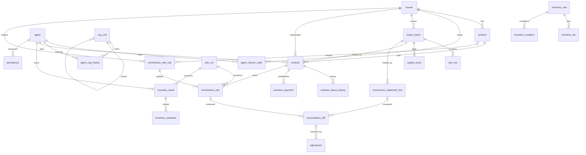

# 02. 데이터 모델

DDL은 `schema/schema.sql`에 있다. 여기서는 설계 의도와 키를 설명한다.

## 1. 키 설계 원칙

| 대상 | 내부 키 | 자연 키 | 비고 |
|------|---------|---------|------|
| 계약 | `contract_id` | `insurer_id` + `policy_no`(정규화) | 증권번호는 공백·하이픈 제거, 대문자 통일 후 저장 |
| 설계사 | `agent_id` | 내부 사번 `internal_code` | 보험사별 설계사 코드는 `agent_insurer_code`로 별도 매핑 |
| 상품 | `product_id` | `insurer_id` + `product_code` | 보험사 상품 코드가 바뀌면 새 레코드 + 적용 기간 |
| 기간 | `period_ym` | `YYYYMM` 문자열 | 모든 월 단위 데이터의 공통 축 |
| 적재 | `batch_id` | 파일 해시 | 모든 Core 레코드는 출처 배치를 가리킨다 |

## 2. 테이블 그룹

### 2.1 마스터
- `insurer` 보험사
- `product` 상품 (환산율, 상품군, 적용 기간)
- `agent` 설계사 (위촉일, 해촉일, 상태)
- `agent_insurer_code` 설계사의 보험사별 코드 (적용 기간)
- `org_unit` 조직 (본부/지사/지점/팀 계층)
- `agent_org_history` 설계사 소속 이력 (월 집계 기준)
- `commission_rate_rule` 수수료율 규칙
- `clawback_rule` 환수 비율표
- `incentive_rule` / `incentive_tier` / `incentive_condition` 구간시상 규칙

### 2.2 수집
- `import_batch` 적재 배치 (보험사, 유형, 대상 월, 파일명, 해시, 건수, 상태, 버전)
- `raw_row` 원본 행 보존 (JSON 텍스트)
- `quality_issue` 품질검증 결과

### 2.3 Core (업적)
- `contract` 계약 원장 (현재 상태 포함)
- `contract_status_history` 상태 변경 이력
- `premium_payment` 회차별 납입
- `persistency` 유지율 (설계사 × 월 × 종류)

### 2.4 Core (정산서)
- `commission_statement_line` 보험사 정산서 라인 (표준화된 형태)

### 2.5 계산
- `calc_run` 계산 실행 (대상 월, 유형, 실행자, 규칙 스냅샷)
- `commission_calc` 내부 수수료 계산 결과
- `incentive_result` 구간시상 결과
- `incentive_clawback` 시상 환수

### 2.6 점검·마감
- `reconciliation_diff` 대사 차이
- `adjustment` 보정 레코드
- `close_period` 월 마감 상태
- `audit_log` 감사 로그

## 3. ERD



## 4. 주요 테이블 상세

### contract (계약 원장)
| 컬럼 | 설명 |
|------|------|
| contract_id | 내부 PK |
| insurer_id, policy_no | 자연 키 (유니크) |
| product_id | 상품 |
| agent_id | 모집 설계사 (내부) |
| contract_date | 계약(성립)일 |
| perf_date | **업적 기준일** (내부 정책으로 통일한 날짜) |
| perf_ym | 업적 귀속 월 (`YYYYMM`) |
| payment_mode | 월납/연납/일시납 등 |
| premium | 원 보험료 |
| premium_monthly | 월납 환산 보험료 |
| converted_premium | 환산보험료 (premium_monthly × 상품 환산율) |
| status | 유지/실효/해지/철회/만기 |
| status_date | 현재 상태 시작일 |
| source_batch_id | 최초 적재 배치 |

### commission_rate_rule (수수료율 규칙)
| 컬럼 | 설명 |
|------|------|
| insurer_id | 보험사 |
| product_id | 특정 상품 (NULL이면 상품군 기준) |
| product_category | 상품군 (product_id가 NULL일 때) |
| commission_type | 초회 / 계속 / 유지 / 시책 |
| installment_from, installment_to | 적용 회차 범위 (예: 1~1, 2~12, 13~24) |
| basis | 계산 기준 (monthly_premium / converted_premium / annual_premium) |
| rate | 요율 (0.85 = 85%) |
| effective_from, effective_to | 적용 기간 |
| priority | 상품 지정 규칙이 상품군 규칙보다 우선 (낮을수록 우선) |

계산 시 "계약의 상품·회차·납입월이 들어맞는 규칙 중 priority가 가장 낮은 것 하나"를 고른다.

### incentive_rule / incentive_tier / incentive_condition (구간시상)
```
incentive_rule
  rule_id, name, period_type(month/quarter), metric(converted_premium/count/...),
  scope(all/insurer/product_category), scope_value, effective_from, effective_to,
  clawback_months (시상 환수 감시 기간)

incentive_tier
  rule_id, tier_no, min_value, max_value(NULL=무한), reward_type(rate/fixed), reward_value

incentive_condition
  rule_id, condition_type(persistency_13/min_count/tenure_months/exclude_product_category),
  operator(>=,<=,=,in), value
```

예: "월 환산P 300만 이상 → 환산P의 20%, 500만 이상 → 30%, 단 13회차 유지율 85% 이상 & 3건 이상"
→ tier 2줄 + condition 2줄로 표현된다.

### reconciliation_diff (대사 차이)
| 컬럼 | 설명 |
|------|------|
| period_ym, insurer_id | 대상 월, 보험사 |
| policy_no, commission_type, installment_no | 매칭 키 |
| statement_line_id | 보험사 정산서 라인 (없으면 NULL = 내부 단독) |
| calc_id | 내부 계산 (없으면 NULL = 보험사 단독) |
| statement_amount, internal_amount, diff_amount | 금액 |
| diff_type | rate / missing_contract / status_mismatch / conversion / insurer_only / internal_only / rounding |
| status | open / confirmed / adjusted / ignored |
| assignee, note, resolved_at | 처리 정보 |

## 5. 시간축 처리 규칙

1. 마스터(수수료율, 환산율, 시상 규칙, 조직 소속)는 모두 `effective_from`/`effective_to`를 가진다.
2. 계산은 항상 **대상 월의 기준일에 유효한 마스터**를 사용한다. 지금 마스터를 고쳐도 과거 월 재계산 결과가 달라지지 않는다.
3. `calc_run`은 실행 시점의 규칙 ID 목록을 JSON으로 스냅샷해 둔다.
4. 마감된 월(`close_period.status = closed`)에 대한 Core 추가·Calc 재실행은 차단되고, 보정은 `adjustment`로만 한다.
